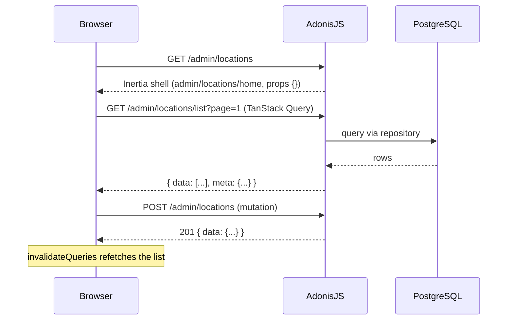

# Architecture

This guide explains how a request moves through the app and where each kind of code lives. Read it once before your first change.

## The big picture

The app is a monolith. One AdonisJS server does two jobs:

1. **Renders page shells** through Inertia.js. A shell is a React page with no data, only route ids such as `{ id }`.
2. **Serves a JSON API** that those pages call with TanStack Query.



Records are **never** passed as Inertia props. This keeps every page refreshable through `invalidateQueries` after a mutation, without a full reload.

## Two areas, two account types

| | Back office | Storefront |
|---|---|---|
| Who | Staff (`User`, `#models/user`) | Shoppers (`Customer`, `#models/customer`) |
| URLs | `/admin/*` | `/`, `/account/*` |
| Session guard | `web` | `customer` |
| Login page | `/admin/login` | `/login` |
| Signup | None. Use `node ace create:admin-user` or `/admin/users/create` | `/signup` |
| Pages | `inertia/pages/admin/` | `inertia/pages/customers/` |
| Controllers | `app/controllers/admin/` | `app/controllers/customers/` |
| Current account | `useAdminMe()` → `GET /admin/me` | `useCustomerMe()` → `GET /account/me` |

Always name the guard explicitly: `middleware.auth({ guards: ['web'] })`, `auth.use('customer')`. Never rely on the default guard. A Customer must never reach `/admin/*`.

## Backend request flow

```
Route (start/routes.ts)
  → middleware (auth, can, UUID param check)
  → Controller   app/controllers/     validate input, call one service
  → Service      app/services/        business logic
  → Repository   app/repositories/    every database query and transaction
  → Model        app/models/          Lucid model
  ← Transformer  app/transformers/    shape the JSON response
```

### Layers

- **Validators** (`app/validators/`, VineJS): one per file. Every mutation and every list endpoint that reads query strings validates its input. Example: `admin_location_store_validator.ts`.
- **Controllers**: single-action classes with a `handle()` method, one per route. They validate, call a service and serialize. No database access. Example: `admin_locations_store_controller.ts`.
- **Services**: business logic and defaults. Injected into controllers with `@inject()`. Example: `location_service.ts`.
- **Repositories**: the only place that touches Lucid models or `db`. Example: `location_repository.ts`.
- **Transformers**: extend `BaseTransformer` and pick the fields to expose. Controllers return `ctx.serialize(XTransformer.transform(record))` (wraps in `{ data }`) or `XTransformer.paginate(rows, meta)` (adds `meta`).
- **Policies** (`app/policies/`): record-level rules, such as "the default location can't be archived".

### Routes and controllers

Controllers are referenced through a generated barrel, which the dev server regenerates whenever you add a controller file:

```ts
router.get('locations', [controllers.admin.AdminLocationsHome]).as('admin.locations.home')
```

Route names follow `resource.action`. GET routes use `home`, `list`, `create`, `edit`, `view`. Mutations use `store`, `update`, `delete`, `archive`, `unarchive`.

### Middleware

Registered in `start/kernel.ts`:

- `silent_auth_middleware`: loads the signed-in account when there is one.
- `uuid_route_param_middleware`: rejects a malformed `:id` route param before the controller runs, so controllers can trust `params.id`.
- `initialize_bouncer_middleware`: preloads the staff User's role and permissions.
- Named: `auth`, `guest`, and `can` (permission check).

### Models and the database

- Every model extends `BaseAppModel`, which generates a UUID v7 `id` and declares `id`, `createdAt` and `updatedAt`.
- Schema generation is off, so declare columns by hand with `@column()`.
- Migrations use `table.uuid('id').primary()` and must be reversible (no raw SQL). Create them with `node ace make:migration <name>`.

## Authorization (staff only)

Staff permissions are stored in the database and edited at **Team & Permissions** (`/admin/roles`).

- **Catalog**: `app/abilities/permissions.ts` lists every resource and action. Keys look like `locations.archive`.
- **Roles**: `admin` is locked and has every permission. `staff` is the default role for new Users. Seeded by `database/seeders/role_seeder.ts`.
- **Route guard**: `.use(middleware.can({ permission: 'locations.view' }))` on every admin route.
- **Record rules**: `await ctx.bouncer.with(LocationPolicy).authorize('archive', location)`. Business-rule denials return `AuthorizationResponse.deny(message, 422)`.
- **Frontend**: `useCan('locations.create')` hides buttons, and `permission` on an `admin_nav.ts` item hides the nav link. This is cosmetic. The server always enforces.

## Frontend

```
inertia/
  app.tsx            Client entry, QueryClientProvider
  layouts/           AdminLayout and storefront layout
  components/
    form/            FormInput, FormInputNumber, FormSelect, FormButton, ...
    data_table/      DataTable, InfiniteDataTable, DataTableToolbar, DataTableLoadMore
    page.tsx         <Page> shell: eyebrow, title, actions
    admin/admin_nav.ts   Back-office navigation
  lib/
    http.ts          http() fetch helper
    form.ts          zodFieldErrors, handleMutationError, emptyToNull
    styles.ts        Shared Tailwind class tokens
  pages/
    admin/<feature>/     home.tsx, edit.tsx, _hooks.ts, _types.ts
    customers/...
```

### Per-feature files

Each page folder has:

- `_types.ts`: Zod schemas and the types inferred from them. Schemas are never defined inline in components.
- `_hooks.ts`: fetch functions and TanStack Query hooks, plus a query key factory such as `adminLocationsKeys`.
- `home.tsx`, `create.tsx`, `edit.tsx`: the pages. Files starting with `_` (for example `_location_dialog.tsx`) are private to the folder.

### The `http()` helper

`http(url, { method, body, schema })` in `inertia/lib/http.ts`:

- Sends the Shield `X-XSRF-TOKEN` header on mutations (required, or Shield rejects the request).
- Parses the response with the Zod schema you pass in.
- Throws `HttpError`. For VineJS 422 responses, `error.fieldErrors` maps field names to messages, ready for the form.

### UI rules

- Use the components in `inertia/components/form/` instead of raw `<input>` and `<button>`. Numbers always use `<FormInputNumber />`.
- Pages are mobile-first and must work down to 320px wide. List pages use `DataTableToolbar` + `InfiniteDataTable`.
- Create, edit and detail pages link back to their parent list through `<Page eyebrow={<Link route="...">} />`.

## Tests

- **Unit** (`tests/unit/`): services and pure logic.
- **Functional** (`tests/functional/`): real HTTP calls against the test database. Wrap each test in a transaction with `group.each.setup(() => testUtils.db().withGlobalTransaction())`, and sign in with `client.get(...).withGuard('web').loginAs(user)`.
- `tests/helpers/admin.ts` → `createAdminUser('admin')` or `createAdminUser(['locations.view'])` creates a staff User with exactly those permissions.

See `tests/functional/admin/admin_locations.spec.ts` for a complete example.
