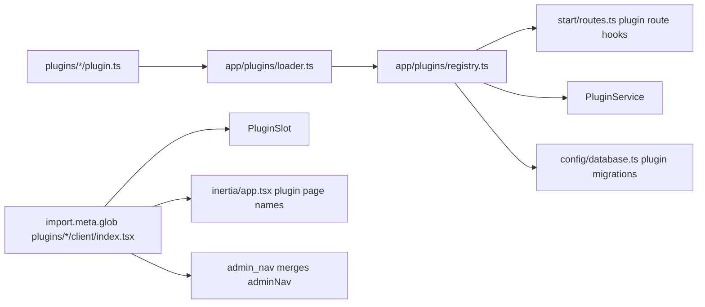

# Creating a plugin

Plugins are optional storefront features, such as the home hero slideshow, that staff turn on and off from **Plugins** in the back office (`/admin/plugins`). They ship with the app: a plugin is a folder under `plugins/`, not a package downloaded at runtime.

Drop a folder into `plugins/<key>/` and the app discovers it automatically (server routes, migrations, tests, storefront component, admin pages, sidebar links). You should not need to edit core files.

A plugin fills one or more **slots**. A slot is a named placeholder in a storefront template, for example `home.hero`. When the plugin is installed it renders in that slot. When it is not, the template shows the slot's fallback, or nothing.

Use the **Hero slideshow** plugin as the reference: `plugins/hero_slideshow/`.

| Part | Reference |
|---|---|
| Folder layout | `plugins/hero_slideshow/` |
| Server entry | `plugins/hero_slideshow/plugin.ts` |
| Shared manifest | `plugins/hero_slideshow/manifest.ts` |
| Slot names (core) | `app/constants/plugins.ts` (`PLUGIN_SLOTS`) |
| Loader and registry | `app/plugins/loader.ts`, `app/plugins/registry.ts` |
| Installed state | `app/services/plugin_service.ts`, table `plugin_installations` |
| Route gating | `app/middleware/plugin_installed_middleware.ts` |
| Client registry | `inertia/plugins/registry.ts` (`import.meta.glob` on `plugins/*/client/index.tsx`) |
| Slot placeholder | `inertia/plugins/plugin_slot.tsx`, used in `inertia/pages/home.tsx` |
| Marketplace page | `inertia/pages/admin/plugins/home.tsx` |
| Tests | `plugins/hero_slideshow/tests/`, `tests/unit/plugin_service.spec.ts`, `tests/functional/admin/admin_plugins.spec.ts` |

The example below adds a made-up `trust_badges` plugin that shows payment and delivery badges below the first product rail on the home page.

## Folder layout

```
plugins/trust_badges/
  manifest.ts            key, name, description, category, slots, defaultInstalled, adminRoute
  plugin.ts              definePlugin({ manifest, routes?, prefetch?, mediaUsages? })
  server/                models, services, controllers, validators, routes.ts, …
  migrations/            Lucid migrations for this plugin only
  client/
    index.tsx            default export: { slot, Component, Skeleton?, seedQueries?, adminNav? }
    …                      storefront UI and hooks
    pages/admin/         Inertia admin pages (rendered as plugins/trust_badges/admin/…)
  tests/
    unit/
    functional/
```

**Imports:** Plugin server code may import from core (`#services/*`, `#models/*`, shared validators). Core must not import a plugin except through the loader (`#plugin_host/registry`). Within a plugin, prefer relative imports under `server/` and `client/`.

Core must also never name a plugin's tables, in queries or in core migrations. Plugin migrations run after every core migration, so a core migration that touches a plugin table fails on a fresh database.

After adding migrations, run `node ace migration:run` (or `migration:fresh` in development). Lucid records migrations by path, so moving a migration between core and a plugin requires a fresh migrate in dev.

## How it fits together



The server decides **whether** a plugin is installed. The client registry decides **what** it renders. A plugin only shows on the storefront when it is in both.

## 1. Pick a slot

Available slots are listed in `PLUGIN_SLOTS` in `app/constants/plugins.ts`:

| Slot | Where it renders |
|---|---|
| `home.hero` | Top of the home page |
| `home.after_first_rail` | Home page, below the first product rail |
| `home.footer` | Home page, below the bottom promo banners |
| `checkout.payment` | Reserved for payment plugins; not placed in a template yet |

To add a new slot:

1. Add the name to `PLUGIN_SLOTS` in `app/constants/plugins.ts`.
2. Add it to `PluginSlotName` in `inertia/plugins/types.ts`. The two lists must match.
3. Place it in the template:

```tsx
<PluginSlot name="home.after_first_rail" />
```

`PluginSlot` accepts optional `fallback` (when no installed plugin fills the slot) and `loading` (while installed plugins load on client navigation).

## 2. Manifest and server entry

Create `plugins/trust_badges/manifest.ts`:

```ts
import type { PluginManifest } from '#constants/plugins'

const manifest = {
  key: 'trust_badges',
  name: 'Trust badges',
  description: 'Payment and delivery badges below the first product rail.',
  category: 'storefront',
  slots: ['home.after_first_rail'],
  defaultInstalled: false,
  adminRoute: null,
} satisfies PluginManifest

export default manifest
```

The folder name must match `manifest.key`.

Create `plugins/trust_badges/plugin.ts`:

```ts
import { definePlugin } from '#plugin_host/types'
import manifest from './manifest.js'
import { admin, storefront } from './server/routes.js'

export default definePlugin({
  manifest,
  routes: { admin, storefront },
})
```

Register routes in `server/routes.ts` the same way as core routes, using lazy controller imports and `middleware.plugin({ key: 'trust_badges' })` on every admin and storefront route that belongs to the plugin.

Render plugin admin pages with `pluginPage('trust_badges', 'admin/hero')` from `#plugin_host/pages` (returns `plugins/trust_badges/admin/hero` for Inertia).

| Manifest field | Meaning |
|---|---|
| `key` | Unique, snake_case, permanent (stored in the database) |
| `category` | One of `PLUGIN_CATEGORIES` |
| `slots` | Slots this plugin fills |
| `defaultInstalled` | Installed until staff uninstall; use `false` for new plugins |
| `adminRoute` | Route name for **Configure** in the marketplace, or `null` |

To ship default-installed on existing stores, add a migration under `plugins/<key>/migrations/` that inserts into `plugin_installations` (see `plugins/hero_slideshow/migrations/*_seed_hero_slideshow_installation.ts`).

## 3. Storefront component

Create `plugins/trust_badges/client/index.tsx`:

```tsx
import type { PluginSlotProps } from '~/plugins/types'
import TrustBadges from './trust_badges'

export default {
  slot: 'home.after_first_rail' as const,
  Component: function TrustBadgesPlugin(_props: PluginSlotProps) {
    return <TrustBadges />
  },
}
```

The client registry picks this up automatically; do not edit `inertia/plugins/registry.ts` by hand.

If the plugin needs data on first paint, add `prefetch.home(ctx)` on the server entry and `seedQueries(queryClient, data)` on the client entry (see hero slideshow). Prefetched plugin payloads appear on `prefetch.plugins[].data` for the matching `key`. A prefetch that throws is logged and left out, so the component must still be able to fetch its own data.

Export a `Skeleton` component to show in the slot while installed plugins load on client-side navigation.

If the plugin stores media gallery images, add `mediaUsages(key)` to the server entry so the gallery refuses to delete an image a plugin record still shows:

```ts
async mediaUsages(key) {
  const rows = await db.from('trust_badges').where('image', key).select('label')
  return rows.map((row) => ({ type: 'trust_badge', label: `Trust badge: ${row.label}` }))
},
```

Optional sidebar links under **Storefront content** (or another section):

```ts
adminNav: {
  parentRoute: 'admin.storefront_content.home',
  items: [{ label: 'Trust badges', route: 'admin.trust_badges.home', permission: 'storefront.view' }],
},
```

## 4. Admin pages

Put Inertia pages under `plugins/trust_badges/client/pages/admin/`. They resolve as `plugins/trust_badges/admin/<file>` without listing them in `adonisrc` `indexPages` (the glob in `inertia/app.tsx` handles it).

Shared storefront link helpers stay in core (`inertia/pages/admin/storefront/_link.ts`, etc.) and are imported with `~/pages/admin/storefront/...`.

## 5. Tests

Add specs under `plugins/trust_badges/tests/unit/` and `plugins/trust_badges/tests/functional/`. They are included automatically via `adonisrc.ts` test suites.

For gated routes, assert 404 after uninstall (see `tests/functional/admin/admin_plugins.spec.ts`).

## 6. Install it

1. Run `yarn dev` and sign in with `plugins.edit`.
2. Open **Plugins** (`/admin/plugins`).
3. **Install** / **Uninstall** and confirm the storefront slot updates.

Uninstalling does not delete plugin data; reinstalling restores behavior.

## Removing a plugin

Delete its folder and restart (or rebuild). Its routes, marketplace card, sidebar links and slot component disappear, and the slot shows its fallback. Its tables, rows and `plugin_installations` row stay in the database and are ignored. Don't roll back its migrations after deleting the folder; Lucid needs the files to do that.

A plugin folder that fails to load (syntax error, bad manifest, duplicate key) is logged at error level and skipped; the rest of the app boots normally.

## 7. Before opening a PR

```bash
yarn typecheck
yarn lint:check
yarn test
```

Install and uninstall from `/admin/plugins` and check the storefront at 320px, 390px, and 720px wide.
