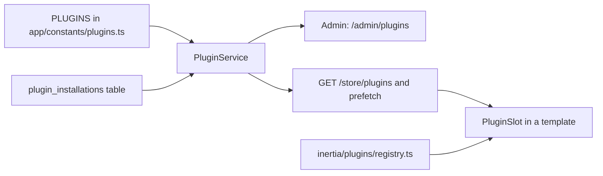

# Creating a plugin

Plugins are optional storefront features, such as the home hero slideshow, that staff turn on and off from **Plugins** in the back office (`/admin/plugins`). They ship with the app: a plugin is code in this repository, not a package downloaded at runtime.

A plugin fills one or more **slots**. A slot is a named placeholder in a storefront template, for example `home.hero`. When the plugin is installed it renders in that slot. When it is not, the template shows the slot's fallback, or nothing.

Use the **Hero slideshow** plugin as the reference and open these files alongside this guide:

| Part | Reference file |
|---|---|
| Plugin list and slot names | `app/constants/plugins.ts` |
| Installed state | `app/services/plugin_service.ts`, table `plugin_installations` |
| Route gating | `app/middleware/plugin_installed_middleware.ts` |
| Storefront component | `inertia/plugins/hero_slideshow/` |
| Client registry | `inertia/plugins/registry.ts` |
| Slot placeholder | `inertia/plugins/plugin_slot.tsx`, used in `inertia/pages/home.tsx` |
| Marketplace page | `inertia/pages/admin/plugins/home.tsx` |
| Tests | `tests/unit/plugin_service.spec.ts`, `tests/functional/admin/admin_plugins.spec.ts` |

The example below adds a made-up `trust_badges` plugin that shows payment and delivery badges below the first product rail on the home page.

## How it fits together



The server decides **whether** a plugin is installed. The client registry decides **what** it renders. A plugin only shows on the storefront when it is in both.

## 1. Pick a slot

The available slots are listed in `PLUGIN_SLOTS` in `app/constants/plugins.ts`:

| Slot | Where it renders |
|---|---|
| `home.hero` | Top of the home page, in place of the default hero |
| `home.after_first_rail` | Home page, below the first product rail |
| `home.footer` | Home page, below the bottom promo banners |
| `checkout.payment` | Reserved for payment plugins; not placed in a template yet |

To add a new slot:

1. Add the name to `PLUGIN_SLOTS` in `app/constants/plugins.ts`.
2. Add it to `PluginSlotName` in `inertia/plugins/types.ts`. The two lists must match.
3. Place it in the template:

```tsx
<PluginSlot name="product.below_description" />
```

`PluginSlot` takes two optional props: `fallback` (shown when no installed plugin fills the slot) and `loading` (shown while the installed plugins load on client-side navigation).

## 2. Register the plugin on the server

Add an entry to `PLUGINS` in `app/constants/plugins.ts`:

```ts
{
  key: 'trust_badges',
  name: 'Trust badges',
  description: 'Payment and delivery badges below the first product rail on the home page.',
  category: 'storefront',
  slots: ['home.after_first_rail'],
  defaultInstalled: false,
  adminRoute: null,
},
```

| Field | Meaning |
|---|---|
| `key` | Unique, snake_case and permanent. It is stored in the database, so never rename it. |
| `category` | One of `PLUGIN_CATEGORIES` (`storefront`, `payments`, `marketing`). Add a new one there if needed. |
| `slots` | The slots the plugin fills. |
| `defaultInstalled` | Whether the plugin counts as installed before staff ever touch it. Use `false` for new plugins so existing stores don't change on deploy. |
| `adminRoute` | Name of the back-office page where staff configure the plugin, or `null` if it has no settings. The marketplace shows a **Configure** button that links there. |

That is all the server needs. The plugin now appears in the marketplace, and the install and uninstall endpoints accept its key.

## 3. Build the storefront component

Create `inertia/plugins/trust_badges/index.tsx`. The component receives the slot's `fallback`:

```tsx
import { ShieldCheck, Truck } from 'lucide-react'
import { cn, storefront } from '~/lib/styles'
import type { PluginSlotProps } from '../types'

export default function TrustBadgesPlugin(_props: PluginSlotProps) {
  return (
    <section className={cn(storefront.section, 'flex flex-wrap justify-center gap-6')}>
      <span className="inline-flex items-center gap-2 text-[14px]">
        <ShieldCheck size={16} /> Secure checkout
      </span>
      <span className="inline-flex items-center gap-2 text-[14px]">
        <Truck size={16} /> Delivered to your door
      </span>
    </section>
  )
}
```

If the plugin loads its own data, keep its hooks in the plugin folder (see `inertia/plugins/hero_slideshow/_hooks.ts`). Show a skeleton while loading, and render `fallback` when there is nothing to show, so the template still looks complete.

## 4. Register the component on the client

Add it to `inertia/plugins/registry.ts`, using the same key as the server:

```ts
import TrustBadgesPlugin from './trust_badges'

export const pluginRegistry: Record<string, PluginEntry> = {
  hero_slideshow: { slot: 'home.hero', Component: HeroSlideshowPlugin },
  trust_badges: { slot: 'home.after_first_rail', Component: TrustBadgesPlugin },
}
```

When several installed plugins fill the same slot, they render in registry order.

## 5. Plugins with data or settings (optional)

Most real plugins store something: the hero slideshow keeps its slides in `storefront_hero_slides`. For a plugin with its own data:

1. Build the tables, models, services, controllers and admin page like any other feature. Follow [adding-a-feature.md](adding-a-feature.md).
2. Guard **every** route that belongs to the plugin, both admin and storefront, so it returns 404 while the plugin is uninstalled:

```ts
router
  .get('store/trust-badges', [controllers.storefront.StorefrontTrustBadgesList])
  .as('storefront.trust_badges.list')
  .use(middleware.plugin({ key: 'trust_badges' }))
```

3. Set `adminRoute` in the manifest to the admin page's route name.
4. To link the admin page from the sidebar, add the entry in `inertia/components/admin/admin_nav.ts` with `plugin: 'trust_badges'`. The link is then hidden while the plugin is uninstalled.
5. If the data is needed on the first server render, load it in `app/services/storefront_prefetch_service.ts` only when the plugin is installed (see how `home()` checks `installedKeys` for `hero_slideshow`).

Small settings that don't justify their own table can go in the `settings` JSON column of `plugin_installations`.

Uninstalling never deletes a plugin's data. Reinstalling brings everything back.

## 6. Install it

1. Run `yarn dev` and sign in to the back office as a User with the `plugins.edit` permission. The admin role has it.
2. Open **Plugins** in the sidebar (`/admin/plugins`).
3. Click **Install** on the plugin's card. It shows on the storefront straight away.
4. Click **Uninstall** to remove it from the storefront. Its routes return 404 and its sidebar links are hidden.

Staff need `plugins.view` to see the marketplace and `plugins.edit` to install or uninstall. Grant them to other roles under **Team & Permissions**.

To ship a plugin already installed on existing stores, set `defaultInstalled: true`, or insert its row in a migration like `database/migrations/*_create_plugin_installations_table.ts` does for `hero_slideshow`.

## 7. Tests

- Add the plugin's own feature tests, like any other feature.
- If it has gated routes, add a functional test that they return 404 after uninstalling. Copy the "route gating" group in `tests/functional/admin/admin_plugins.spec.ts`.

## 8. Before opening a PR

```bash
yarn typecheck
yarn lint:check
yarn test
```

Then install and uninstall the plugin from `/admin/plugins` and check the storefront with each, at 320px, 390px and 720px wide.
