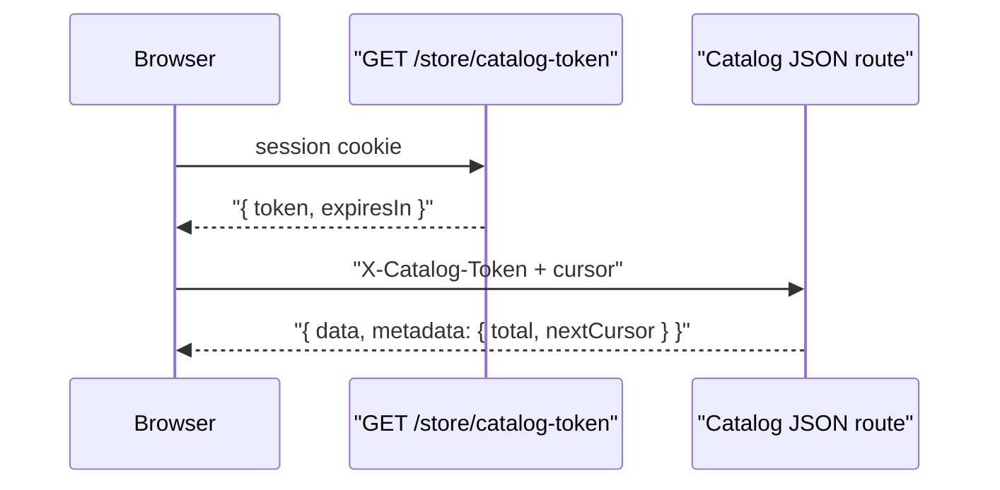

# Security

This guide explains the protections built into Akinai, where each one lives in the code, and how to keep them in place when you add a feature. Limits and lifetimes below match the current defaults in source; treat them as documentation of the shipped hardening, not as a substitute for keeping dependencies and `main` up to date.

To **report a vulnerability**, see [SECURITY.md](../SECURITY.md) (private disclosure only).

Contributor conventions that reinforce these rules also live in `.cursor/rules/` (`owasp-security.mdc`, `theme-template-security.mdc`, `customer-resource-ownership.mdc`, `public-form-recaptcha.mdc`, `validator-strict-types.mdc`, `inertia-no-direct-injection.mdc`).

## Accounts and sessions

Staff and shoppers are separate accounts with separate tables, models and session guards.

| | Staff (`User`) | Shopper (`Customer`) |
|---|---|---|
| Guard | `web` | `customer` |
| Routes | `/admin/*` | `/`, `/account/*` |
| Signup | None. `node ace create:admin-user` or an existing admin | `/signup`, with an emailed code |

- Routes always name their guard: `middleware.auth({ guards: ['web'] })`. A Customer session can never reach `/admin/*`.
- **Session cookie** (`config/session.ts`): `adonis-session`, `httpOnly`, `sameSite: lax`, `secure` in production, idle timeout 2 hours.
- **Session fixation:** the session id is regenerated on login, logout, staff password change and impersonation.
- **Sign out everywhere on password change:** a password change bumps the account's session version. `customer_session_version_middleware` and `user_session_version_middleware` sign out every other session that still carries the old version.
- The signed-in account is never shared as an Inertia prop. Pages fetch it from `/admin/me` or `/account/me`.

## Passwords and one-time codes

- **Hashing:** scrypt (`config/hash.ts`).
- **New passwords** (`app/validators/helpers/customer_password.ts`): 12 to 128 characters, with no character-mix rules (per NIST SP 800-63B). They're also rejected if they appear in known breaches. That check uses the HaveIBeenPwned range API (`app/utils/pwned_password.ts`), so only the first 5 characters of the SHA-1 hash leave the server. It is controlled by `PWNED_PASSWORDS_ENABLED`, and skipped if the service is down.
- **Sign-in passwords** are capped at 128 characters so hashing stays cheap.
- **Brute force** (`LoginThrottleService`): 5 wrong passwords for the same email from the same IP block that pair for 20 minutes. This sits on top of the per-IP `loginThrottle`.
- **Signup and password reset codes** (`CustomerVerificationCodeService`):
  - 6 digits, valid for 10 minutes, 60 seconds between resends.
  - Locked after 5 wrong guesses.
  - Stored as an HMAC keyed with `APP_KEY` and bound to the email and purpose, so a stored hash can't be used for another email or flow.
- **Sensitive account changes** (email, password, MFA) require the current password.

## Staff two-factor authentication

`UserMfaService`, `RequireMfaMiddleware`, `app/constants/user_mfa.ts`

- TOTP codes from an authenticator app, with 30 seconds of clock tolerance.
- The secret is encrypted at rest (purpose `user-mfa`).
- Every accepted time step is recorded, so the same code can't be used twice.
- 10 single-use recovery codes, stored as keyed hashes.
- 5 wrong codes block MFA for 20 minutes.
- A half-finished MFA login expires after 5 minutes.

## Authorization

- **Staff permissions** (Bouncer):
  - Each User has one role. The permission catalog is `app/abilities/permissions.ts`.
  - Every admin route uses `middleware.can({ permission })`, and record rules live in `app/policies/`.
  - `admin` is a locked role with every permission. Hiding buttons on the frontend (`useCan`) is cosmetic; the server always checks.
- **Customer ownership:**
  - Every customer route with an `:id` uses `middleware.customerOwns({ resource })` (`app/middleware/customer_owns_middleware.ts`).
  - Services still look up records scoped to the signed-in customer, as a second layer.
  - Another customer's record returns **404, not 403**, so ids don't leak.
  - Customer endpoints never accept a `customerId` from the browser.
- **Guest checkout orders** are reachable only through `CheckoutService.findPlacedOrder`. The order must have been placed in this session or belong to the signed-in customer.
- **Impersonation** (`ImpersonationService`):
  - Staff can sign in to the storefront as a customer, limited per staff user by `impersonationThrottle`.
  - The staff User stays signed in on `web`, the session records who started it, and the storefront shows a banner.
  - It is audited and doesn't change the customer's `lastLoginAt`.

## Input validation and output

- Every request body, query string and non-`:id` route param goes through a VineJS validator in `app/validators/`.
- **Strict types:** JSON bodies use strict numbers and booleans, so `"5"` and `"on"` are rejected. Strings, numbers and arrays are always bounded.
- `:id` params are checked as UUIDs by the global `UuidRouteParamMiddleware` before the controller runs.
- **Raw SQL** always uses bindings. Sort keys come from an allow-list, and `LIKE` patterns go through `containsPattern()`.
- **Rich text:**
  - `sanitizeEditorHtml` (`app/utils/sanitize_rich_text.ts`) runs on save. It keeps a small allow-list of tags, and links may only use `http`, `https`, `mailto` or `tel`.
  - On the frontend, `sanitizeHtml` (DOMPurify) runs before any `dangerouslySetInnerHTML`.
- **Responses** go through transformers in `app/transformers/` and are never raw models. Secret columns use `serializeAs: null`.
- **No data injected into page shells:** Inertia pages only receive route ids. Data comes from JSON endpoints. The one exception is SEO head tags built by `StorefrontSeoService`.

## Browser protections

Shield (`config/shield.ts`):

- **CSP:**
  - Scripts and styles must be same-origin or carry the per-request nonce.
  - `script-src-attr 'none'`, `object-src 'none'`, `frame-ancestors 'none'`, `base-uri 'self'`, `form-action 'self'`.
  - `upgrade-insecure-requests` in production.
  - Google reCAPTCHA hosts are added only when reCAPTCHA is enabled.
- **CSRF:**
  - Required on POST, PUT, PATCH and DELETE.
  - The frontend sends the `XSRF-TOKEN` cookie as `X-XSRF-TOKEN` through `http()`. The cookie is `sameSite: strict` and `secure` in production.
  - Only the Stripe webhook and the POLi nudge are exempt. They're verified in other ways, see below.
- **Other headers:** `X-Frame-Options: DENY` and `X-Content-Type-Options: nosniff`. HSTS lasts 180 days in production and includes subdomains unless `HSTS_INCLUDE_SUBDOMAINS=false`.
- **No inline styles or scripts for layout.** Use Tailwind classes.

## Bots and abuse

### Rate limits

All limits live in `start/limiter.ts` and are stored in Redis in development and production. Every public, authentication or expensive endpoint has one.

| Area | Limit |
|---|---|
| Login | 10 per minute per IP, then blocked for 15 minutes, plus the per-account limit above |
| Signup, setup, password reset | 5 per minute per IP, then blocked for 15 minutes. Password reset is also limited to 3 per hour per email |
| One-time codes | 10 per minute per IP, then blocked for 15 minutes |
| Checkout | 10 per minute per IP, then blocked for 5 minutes |
| Payments | 10 per minute per IP, then blocked for 5 minutes |
| Cart pricing and checkout quotes | 60 per minute per IP |
| Search | 60 per minute per IP |
| Catalog JSON routes | 120 per minute per IP, plus 300 per 10 minutes per session |
| Catalog tokens | 10 per minute per IP, then blocked for 15 minutes |
| Newsletter | 5 per minute per IP, then blocked for 15 minutes; 3 per hour per email |
| Support tickets | 3 per 10 minutes per IP, then blocked for 30 minutes; 5 per day per email |
| Staff CSV exports and imports | 10 exports and 5 imports per 10 minutes per staff user |

### reCAPTCHA v3 on public forms

Every form a signed-out person can submit is checked by invisible reCAPTCHA v3. Score floor is 0.5 (`app/utils/verify_recaptcha.ts`).

- Each form has its own action name, so a token can't be replayed on another form.
- `middleware.recaptcha({ action })` rejects the request before validation runs.
- Covered forms: login, admin MFA, signup and its code steps, password reset, newsletter, checkout, and support tickets.
- It is turned off when `RECAPTCHA_ENABLED` is unset (local development).

### Catalog anti-scraping

The storefront's catalog JSON routes need a token tied to the visitor's session:

- Collection view, products and filters.
- Product view, reviews list and reviews summary.
- Search.

- **Tokens** (`StorefrontCatalogTokenService`):
  - Encrypted and signed with `APP_KEY`, valid for 15 minutes.
  - Bound to a random nonce stored in the session.
  - `catalogToken` middleware answers `401 { code: 'E_CATALOG_TOKEN' }` when the token is missing, invalid, expired or from another session, and logs a warning for tampered ones.
- **Cursors** replace `?page=N` on collection products and reviews:
  - Each one is encrypted, valid for 30 minutes, and bound to the session and to the exact list: slug, sort and filters.
  - They stop at page 20.
  - A forged cursor, or one reused elsewhere, gets `422`.
- **Frontend:** `inertia/lib/catalog_http.ts` fetches the token once (prefetched by the storefront layout), refreshes it before it expires, and retries once on `E_CATALOG_TOKEN`.
- **Stays public on purpose:** page shells, SEO tags, `sitemap.xml` and `robots.txt`.
- **Limits:** this stops direct API scraping and parallel page enumeration. A headless browser behaving like a shopper is only slowed by the rate limits. Stopping that needs bot protection at the edge (for example Cloudflare).

### Crawlers

`robots.txt` (`SitemapService`) blocks AI training crawlers (GPTBot, CCBot and others) from the whole site. Other crawlers are kept out of private areas.

## Payments and webhooks

- **Stripe webhooks:** the signature is verified with the active mode's webhook secret (`StripeGatewayService.parseWebhook`) before anything happens.
- **POLi nudges:** they only carry a token, and the transaction is looked up with POLi itself, so a forged nudge can't mark an order paid.
- **Server-side totals:** totals, taxes, discounts and shipping are recalculated on the server, and money and stock changes run inside one repository transaction.
- **Gateway keys** are encrypted at rest with their own purposes.

## Themes

Uploaded themes are Edge templates. Edge compiles them to JavaScript and runs that JavaScript in the server process, so a theme is trusted code.

`themeTemplateProblems` in `app/themes/template_policy.ts` allows only the expressions a theme needs: literals, a fixed list of variables and helpers, static property access, numeric indexes, and calls to those helpers or `.slice()`. The check walks the AST Edge compiles. A denylist of source words is not enough, because a name such as `constructor` can be built with concatenation at runtime.

The same check runs on upload, on editor saves, and again before a published or previewed theme is compiled, including themes extracted before the check existed. A theme that fails it is not rendered. Live requests fall back to the built-in storefront.

Give `themes.upload` and `themes.edit` only to staff you would trust with the server. Run the process as a user that is not root, with a read-only root filesystem and restricted egress, so a template bug does not own the container.

## Files and uploads

- Vine validates the extension and size. SVG is never accepted, because it can carry scripts.
- `uploadImage()` (`app/utils/uploader.ts`) decodes and re-encodes every image with sharp. This drops polyglot payloads, hidden scripts and EXIF metadata, including GPS. The server sets the stored file's Content-Type.

## Secrets, logging and errors

- **Secrets:**
  - Secrets live in environment variables declared in `start/env.ts` and `.env.example`, never in code.
  - Secrets at rest use `encryption.encrypt(value, { purpose })`.
  - One-time codes and recovery codes are hashed and compared with `timingSafeEqual`.
- **Log redaction:** `config/logger.ts` redacts the keys in `SENSITIVE_KEYS` (passwords, tokens, cookies, `x-xsrf-token`, `x-catalog-token`, MFA fields and others). Add any new sensitive key there.
- **Audit log:**
  - Model saves and deletes write `audit_logs` rows. Hidden fields are excluded with `auditHidden`.
  - Security events (logins, MFA changes, impersonation, exports and others) go through `AuditLogService.recordSecurityEvent`. Ones worth an alert also log `warn` with an `event` field.
  - Customers see their own changes at `/account/activity`, without ids or staff-only labels.
- **Error responses:** stack traces are shown only in development and test (`app/exceptions/handler.ts`). Production renders status pages.
- **Errors are never swallowed:** no empty `catch {}`, and not-found cases use `orNullIfMissing()`.

## Maintenance mode

- `node ace down` puts the storefront in maintenance.
- `/admin`, `robots.txt`, `sitemap.xml` and the maintenance newsletter form stay reachable.
- The bypass URL sets a hashed cookie. A signed-in staff User sees the storefront with a maintenance banner.

## Other tokens

- **Support threads:** emailed thread links carry an access token that is encrypted at rest and expires after 30 days. `supportThreadViewThrottle` limits guessing.
- **Google and Microsoft sign-in:** the OAuth `state` is checked on the callback. Access-denied and provider errors are handled without signing anyone in.

## Supply chain and CI

- `yarn` only, with `yarn.lock` committed.
- `yarn security:audit` (`scripts/security-audit.sh`) fails on high or critical advisories in production dependencies. Run it after any dependency change.
- CI runs **gitleaks** (`Secret scan` job in `.github/workflows/ci.yml`, config `.gitleaks.toml`) over full git history so committed secrets fail the build. Real env files stay out of git via `.gitignore` (`.env`, `.env.*` except `.env.example` and `.env.test`).
- Dependabot opens weekly update PRs for npm packages and GitHub Actions (`.github/dependabot.yml`).
- GitHub Actions are pinned to commit SHAs.
- Husky runs lint on every commit.

## Checklist for a new feature

Before you open a PR, check the feature against each item. These map to the OWASP Top 10 in `owasp-security.mdc`.

- [ ] **Access:** admin routes have `auth({ guards: ['web'] })` and `can({ permission })`. Customer `:id` routes have `customerOwns` and look up records scoped to the customer.
- [ ] **Input:** every input goes through a strict Vine validator. Any raw SQL uses bindings.
- [ ] **Output:** responses go through a transformer. Nothing secret is serialized.
- [ ] **Abuse:** public, auth and expensive endpoints have a limiter. Public forms have reCAPTCHA.
- [ ] **Money and stock:** changes happen in one transaction, and totals are recalculated on the server.
- [ ] **Secrets:** new env vars are added to `start/env.ts` and `.env.example`. New sensitive keys are added to `SENSITIVE_KEYS`.
- [ ] **Logging:** security events are recorded through `recordSecurityEvent`.
- [ ] **Uploads:** files are validated in Vine and stored through `uploadImage()`.
- [ ] **Dependencies:** `yarn security:audit` passes.
